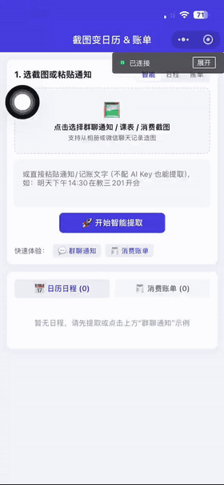

# Snap-to-Calendar：截图一键变日程和账单

微信小程序 + FastAPI 后端。把群聊通知、课程/考试安排、消费记录的**截图或文字**丢进来，自动提取出**日程**（一键加入手机日历）和**账单**（导出 CSV）。

<p align="center">
  
</p>

<p align="center">真机录屏（2 倍速）。完整原速视频：<a href="docs/demo.mp4">docs/demo.mp4</a></p>

## 解决什么问题

群里的通知（“本周五 14:00-16:00 在教学楼A302 开题答辩”）要手动抄进日历，付款截图要一笔笔记账，很麻烦。这个小程序把这一步自动化：

| 功能 | 说明 |
|---|---|
| 截图识别 | 选一张截图，本地 OCR（RapidOCR）识别文字，**不配 AI Key 也能用** |
| 提取日程 | 识别日期（明天 / 下周五 / 12月25日 / 2026-12-01）、时间（14:00-16:00 / 下午2点到4点半）、地点（教学楼A302）和事项 |
| 一键加日历 | 调用 `wx.addPhoneCalendar` 写入手机系统日历 |
| 提取账单 | 一句话里的多笔消费自动拆开（“黄焖鸡 22.5元，奶茶 18元” → 两笔），自动分类（餐饮 / 交通 / 学习…） |
| 导出账单 | 生成带合计行的 CSV，Excel 直接打开 |
| 可选接入大模型 | 在 `.env` 里配置多模态模型（OpenAI 兼容接口或 Gemini），复杂截图识别更准；密钥只放在后端 |

## 技术栈

- **前端**：原生微信小程序（WXML / WXSS / JS）
- **后端**：Python · FastAPI · Pydantic · httpx
- **识别**：RapidOCR（本地 OCR）+ 中文规则解析器；可选多模态大模型
- **测试**：pytest（13 个用例，覆盖日期、时间、地点、多笔账单拆分等）

## 目录结构

```
backend/        FastAPI 后端：/api/extract 提取接口、/api/export-csv 导出接口
  parser.py     本地 OCR + 中文规则解析 + 大模型调用
  tests/        解析器的离线测试
miniprogram/    原生微信小程序前端
docs/           演示录屏
```

## 本地运行

### 1. 启动 Python 后端
在本项目根目录（`snap-to-calendar-mp/`）下执行：
```powershell
cd backend
pip install -r requirements.txt
uvicorn main:app --host 0.0.0.0 --port 8000 --reload
```
- （可选）如需接入大模型，复制 `.env.example` 为 `.env`，填入你的 `AI_API_KEY`、`AI_BASE_URL`、`AI_MODEL`。不填时用本地 OCR + 规则解析。

### 2. 打开微信小程序
1. 打开 **微信开发者工具** → 选择 **导入项目**。
2. 目录选择**本项目根目录**（`snap-to-calendar-mp/`）。根目录的 `project.config.json` 已通过 `miniprogramRoot` 指向 `miniprogram/`。
3. AppID 可先选 **测试号**（`project.config.json` 已设置 `urlCheck: false`，不校验域名）。
4. 即可在模拟器里测试文字提取与示例；点右上角 **「预览」** 用微信扫码可在手机上真实测试 `wx.addPhoneCalendar` 一键加日历（真机调试时把 `miniprogram/app.js` 里的 `127.0.0.1` 改成你电脑的局域网 IP）。

## 运行测试
在 `backend/` 下执行：
```powershell
pip install pytest
python -m pytest
```

## 如果要上传发布小程序
1. 在微信公众平台注册个人小程序账号，拿到正式的 `AppID`，替换根目录 `project.config.json` 里的 `appid`。
2. 后端需要部署到一台有 **HTTPS 备案域名** 的云服务器上（或使用微信云托管），并在微信公众平台「开发管理 → 服务器域名」里把该域名加入 `request合法域名`。
3. 在微信开发者工具点右上角 **「上传」**，然后在微信公众平台提交审核即可。
